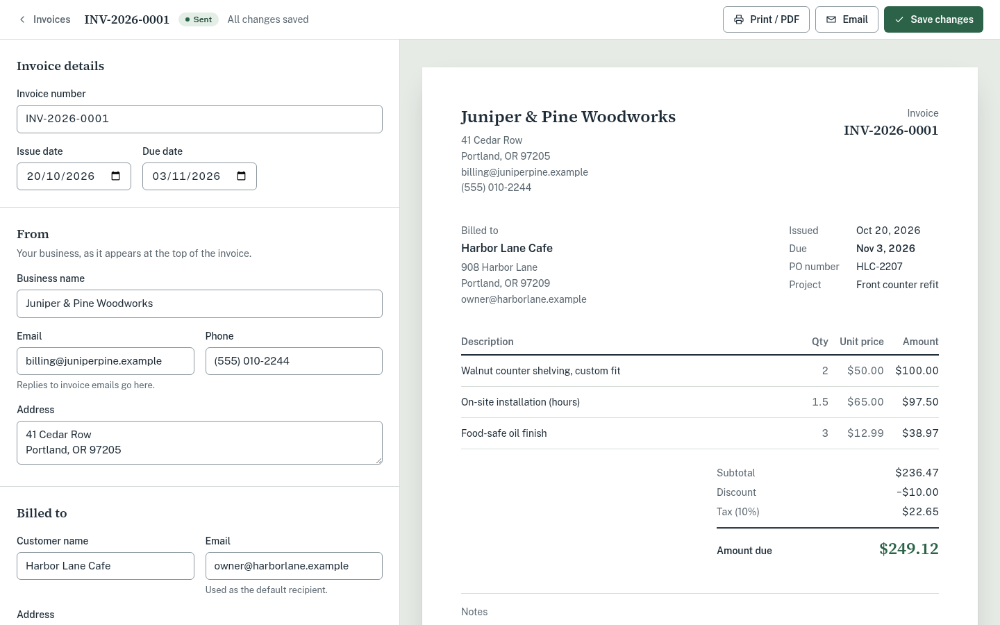
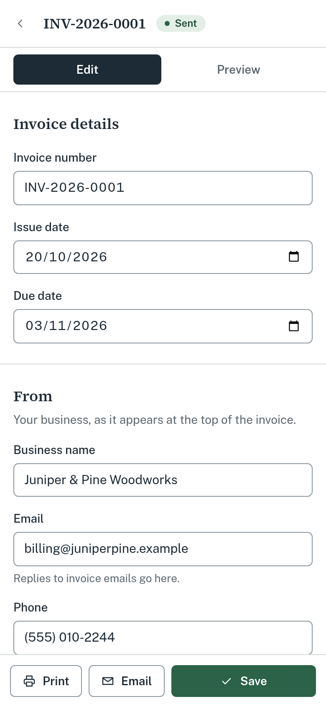
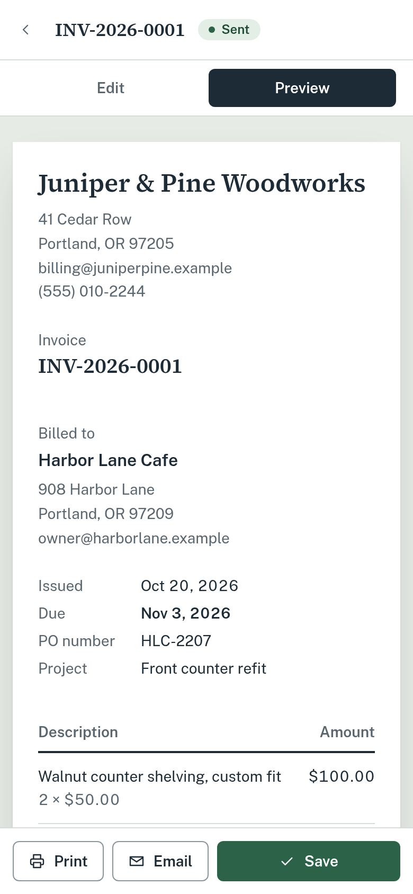
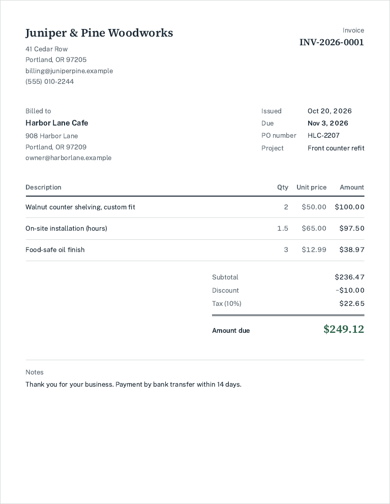

# Folio: a customizable invoice generator

A browser-based invoice tool for small businesses. You fill in an invoice on the left and see the
finished page on the right as you type. You can save it to MongoDB, print it or save it as a PDF, and
email it through any SMTP server.



| Mobile editor                                      | Mobile preview                                         | Printed invoice                                |
| -------------------------------------------------- | ------------------------------------------------------ | ---------------------------------------------- |
|  |  |  |

All names, addresses and emails in the screenshots and seed data are fictional (`.example` domains).

## Features

- **Invoice editor:** business and customer details, invoice number, issue and due dates, and notes.
  Add, edit and remove line items (description, quantity, unit price).
- **USD totals:** line totals, subtotal, a fixed discount, a percentage tax and the amount due. The
  same code calculates totals in the browser and on the server.
- **Custom fields:** add a label and value, edit them, show or hide them, and remove them. Only
  visible fields appear on the invoice, the printout and the email. Custom fields never change the
  totals.
- **Live preview and PDF:** the preview updates on every keystroke. Print / PDF uses the browser's
  print dialog. A print stylesheet prints only the invoice: no buttons, no form and no hidden fields.
  The server also renders a real PDF of a saved invoice: it is attached to emails and available at
  `/api/invoices/:id/pdf`.
- **Saved invoices:** each invoice gets its own URL, so reloading opens it again. The home page lists
  saved invoices with their status. Invoices can be deleted from the list or the editor, and leaving
  with unsaved changes asks first. Both use an in-app confirmation dialog, not the browser's
  `confirm()`.
- **Email:** sends the saved invoice through SMTP as an HTML email with a plain-text version and the
  invoice attached as a PDF (`INV-2026-0001.pdf`). It marks the invoice as sent. Replies go to the
  business email.
- **Keyboard shortcuts:**
  - `N` on the invoice list starts a new invoice
  - `Ctrl/⌘ + S` saves
  - `Ctrl/⌘ + Enter` opens the email dialog, and sends from inside it
  - `Ctrl/⌘ + P` prints only the invoice

  Buttons show their shortcut in a tooltip and in `aria-keyshortcuts`.

- **Validation:** blocks negative quantities, prices, discounts and tax rates, a discount larger than
  the subtotal, a tax rate above 100%, and a due date before the issue date. Each problem shows a
  plain-language message under its field. A failed save moves focus to the first problem.
- **Responsive and accessible:**
  - Two independently scrolling columns on desktop; Edit and Preview tabs on mobile.
  - Labels on every input and a visible focus ring.
  - Text contrast meets WCAG AA.
  - Keyboard access throughout, including a skip link.
  - Focus moves to new line items and custom fields when you add them, and to the next row when you
    remove one.
  - Long unbroken text (an address or reference with no spaces) wraps inside the invoice instead of
    spilling off the page, from 320px phones to print.

## Tech stack

| Part       | Choice                                 | Why                                                                                |
| ---------- | -------------------------------------- | ---------------------------------------------------------------------------------- |
| App        | Next.js 16 (App Router) and TypeScript | One project for UI and API, with one `npm run dev`.                                |
| UI         | React 19 and Tailwind CSS 4            | Design tokens live in `globals.css`.                                               |
| API        | Next.js route handlers                 | Runs only on the server, so SMTP and database credentials never reach the browser. |
| Database   | MongoDB with Mongoose                  | An invoice is one document with embedded line items and custom fields.             |
| Validation | Zod                                    | One schema used by the editor (inline errors) and the API (source of truth).       |
| Email      | Nodemailer over SMTP                   | Works with Mailtrap, Gmail, SES, Postmark and other SMTP services.                 |
| Tests      | Vitest and mongodb-memory-server       | API tests run against a real, throwaway MongoDB.                                   |

## Getting started

**Requirements:** Node.js 20.9+ and MongoDB 6+ (local, Docker or a free MongoDB Atlas cluster).

```bash
npm install
cp .env.example .env.local   # then edit .env.local
npm run seed                 # optional: adds one fictional demo invoice
npm run dev                  # http://localhost:3000
```

No local MongoDB? Either start one with Docker:

```bash
docker run -d -p 27017:27017 mongo:7
```

or paste an Atlas connection string into `MONGODB_URI`.

### Environment variables

All variables are read only on the server. See [`.env.example`](.env.example).

| Variable                  | Example                                       | Purpose                                     |
| ------------------------- | --------------------------------------------- | ------------------------------------------- |
| `MONGODB_URI`             | `mongodb://127.0.0.1:27017/invoice_generator` | Database. It is created on first write.     |
| `SMTP_HOST`               | `sandbox.smtp.mailtrap.io`                    | SMTP server.                                |
| `SMTP_PORT`               | `587`                                         | `587` for STARTTLS, `465` for implicit TLS. |
| `SMTP_SECURE`             | `false`                                       | `true` only for port 465.                   |
| `SMTP_USER` / `SMTP_PASS` |                                               | SMTP credentials.                           |
| `MAIL_FROM`               | `"Folio Invoices <invoices@example.com>"`     | Sender shown to the recipient.              |

### Storage (MongoDB)

- **Database:** set by `MONGODB_URI`. The database and its collection are created on the first save.
  No migrations are needed.
- **One document per invoice** in the `invoices` collection. Line items and custom fields are
  embedded, so each save is a single atomic write. `invoiceNumber` has a unique index.
- **Stored totals:** the server always recalculates them from the line items. They are never taken
  from the browser.
- **Dates:** stored as `YYYY-MM-DD` strings, so they never shift with time zones.
- **Demo data:** `npm run seed` adds one fictional invoice.

### Email setup

Any SMTP provider works. Two quick options:

- **Mailtrap sandbox (recommended for testing):** catches every message in a test inbox, so nothing
  reaches a real customer. Copy the host, port, username and password from _Email Testing → Inboxes →
  SMTP settings_.
- **Gmail:** use `smtp.gmail.com`, port `465`, `SMTP_SECURE=true`, your address as `SMTP_USER`, and
  an [App Password](https://support.google.com/accounts/answer/185833) as `SMTP_PASS`.

Send test emails only to an address you control. If SMTP isn't configured, the app says so in the
email dialog instead of failing silently.

## How totals are calculated

The brief sets the order: round each line, sum, apply the discount, then calculate and round tax.
[`src/lib/invoice-math.ts`](src/lib/invoice-math.ts) implements it:

```
line total  = round(quantity × unit price)            per line, to cents
subtotal    = sum of line totals
taxable     = subtotal − discount                      discount ≤ subtotal
tax         = round(taxable × tax rate / 100)          to cents
amount due  = taxable + tax
```

- All money is stored and calculated as integer cents. Typed amounts are parsed from the string
  (`"0.29"` becomes `29`), so binary floating point never touches money.
- Rounding is half up and exact. Multiplication and division use `BigInt`, which also keeps large
  invoices exact.
- Quantity allows 2 decimals (for example 1.5 hours). The tax rate allows 3 decimals (for example
  8.875%).
- The brief's check passes: `2 × $50 − $10 + 10% tax = $99.00` (see `tests/invoice-math.test.ts`).
- The server never trusts totals sent by the browser. It recalculates them on every save.

## Backend (API)

The backend is a set of Next.js route handlers under `src/app/api`. They run only on the server,
validate every request with the shared Zod schema, and talk to MongoDB through `src/lib/invoices.ts`.

| Method   | Path                     | Description                                                                                                       |
| -------- | ------------------------ | ----------------------------------------------------------------------------------------------------------------- |
| `GET`    | `/api/invoices`          | List invoices (summary).                                                                                          |
| `POST`   | `/api/invoices`          | Create an invoice. Returns `201`; `400` with field errors; `409` if the number is taken.                          |
| `GET`    | `/api/invoices/:id`      | Read one invoice, or `404`.                                                                                       |
| `PUT`    | `/api/invoices/:id`      | Replace an invoice and recalculate its totals.                                                                    |
| `DELETE` | `/api/invoices/:id`      | Delete an invoice. Returns `204`.                                                                                 |
| `GET`    | `/api/invoices/:id/pdf`  | The saved invoice as a PDF (`application/pdf`), the same file that is attached to emails.                         |
| `POST`   | `/api/invoices/:id/send` | Email the **saved** invoice. Body: `{ to, subject, message }`. Limits: 5/min per invoice, 20/min overall (`429`). |

- Errors always have the shape `{ "error": { "message": "...", "fieldErrors": { "lineItems.0.quantity": "..." } } }`.
- Request bodies must be `Content-Type: application/json`; anything else gets `415`. Another website
  can only send form or text bodies without permission, so this blocks cross-site requests from
  creating invoices or sending email.
- If MongoDB can't be reached, the API returns `503` with a clear message instead of a generic `500`.

## Project structure

```
src/
  app/
    page.tsx                     Invoice list
    invoices/new/page.tsx        New invoice (suggests the next number, reuses business details)
    invoices/[id]/page.tsx       Edit a saved invoice
    api/invoices/...             Route handlers (create, read, update, delete, send)
    globals.css                  Design tokens, print stylesheet
  components/
    InvoicePreview.tsx           The invoice "sheet", used for preview and print
    invoice-editor/              Editor state (reducer), form sections, email dialog
  lib/
    invoice-math.ts              Totals and rounding (shared by browser and server)
    invoice-schema.ts            Zod validation (shared)
    money.ts, format.ts          Parsing and formatting
    invoices.ts                  Data access; recalculates totals before saving
    email-template.ts, mailer.ts HTML/text email and SMTP transport
    invoice-pdf.tsx              PDF version of the invoice (react-pdf), attached to emails
  models/Invoice.ts              Mongoose schema
scripts/seed.ts                  Fictional demo data
tests/                           Unit and API tests
```

## Tests and checks

```bash
npm test            # 38 tests: totals, rounding, validation, parsing, editor state, API + MongoDB, email, PDF
npm run lint
npm run typecheck   # generates Next.js route types, then runs tsc
npm run build
```

Checked by hand during development:

- **Full browser flow:** create, validation errors, save, reload, hide a custom field, print to PDF,
  send through a local SMTP server, and leave and delete through the confirmation dialog.
- **Layout stress test:** every text field filled to its maximum length with unbroken text, at 1440,
  1024, 390 and 320px. Nothing overflows the invoice or the page. A 40-line invoice prints across
  pages with the table header repeated and no row split.
- **Failure states:** with MongoDB unreachable, the list shows a clear message, the editor shows an
  error page with **Try again**, and the API returns `503`.
- **Accessibility:** axe-core reports 0 WCAG 2.1 AA violations on the list, editor (desktop, mobile
  and with errors), email dialog and not-found pages. Tested keyboard-only use as well.
- **Security:**
  - HTML and script typed into fields is escaped in the preview and the email.
  - No SMTP or database settings appear in the browser JavaScript bundles.
  - JSON-only request bodies block cross-site requests.
  - Basic security headers are set: `nosniff`, `X-Frame-Options: DENY`, and a referrer policy.
- **Independent review:** a second AI review pass looked for bugs and checked the UI against the
  Vercel Web Interface Guidelines. Its findings were fixed and covered by tests. Examples: amounts
  like `12,34` are no longer misread, numbering continues correctly past `-9999`, and the email rate
  limit no longer trusts a spoofable header.

## Decisions

- **Next.js instead of a separate React app and Express server.** One deployable unit, no CORS, and
  credentials stay server-side by default. Under the hood it is still the MERN stack.
- **Totals in integer cents with exact rounding.** This prevents `$98.99999` style errors. The browser
  and the server share one calculation module, so the preview always matches what's saved.
- **One validation schema everywhere.** The editor shows the same messages the API would return.
  The API stays the source of truth and strips unknown keys, which also stops MongoDB operator
  injection.
- **Emails use the saved invoice, not what's on screen.** If you have unsaved changes, the editor
  saves first. What a customer receives always matches the database.
- **Embedded line items and custom fields.** They are always read and written with their invoice,
  so one document per invoice keeps saves atomic and simple.
- **Dates stored as `YYYY-MM-DD` strings.** An invoice date is a calendar date, not a moment in time,
  so it never shifts by time zone.
- **Text inputs with `inputMode="decimal"` instead of `type="number"`.** People can type `1,200.50`
  or `$20`, mobile shows a numeric keypad, and the field never silently drops input.
- **Two PDF paths.** Print / PDF in the browser prints exactly what's on screen, as the brief asks.
  For the email attachment, the server renders the PDF with `@react-pdf/renderer`. It's pure
  JavaScript, so nobody has to install a headless Chrome (Puppeteer would add ~150 MB). The cost
  is a second, small layout file that mirrors the invoice design. If PDF rendering ever fails, the
  email still goes out, since the invoice is also in the body, and the app says the PDF was missing.
- **Errors appear after you leave a field,** or on save. They don't appear while you type the first
  character, and they stay attached to the right row when a row is removed.
- **Typed numbers are never guessed.** Commas are accepted only as thousands separators
  (`1,234.50`), so `12,34` is flagged instead of being read as $1,234.
- **New invoices use the browser's date.** The default issue and due dates follow the user's time
  zone, not the server's.
- **Design:** the editor is a quiet workbench and the invoice is a sheet of paper on a desk. The
  palette borrows from bookkeeping: navy ledger ink, green-eyeshade green for actions and a sage desk
  surface. The amount due sits under the accountant's double rule. Public Sans handles the interface
  and figures (tabular numerals); Source Serif 4 gives the business name and amount due a printed
  feel.

## AI tools used

I used **Claude Code** (Anthropic) as a pair programmer for planning, writing code and tests, and
running browser checks (screenshots, accessibility audit, print-to-PDF, email through a local SMTP
server). I reviewed and tested every change, and I can explain all of the code. The decisions above
are mine.

## Time spent

About **2 hours 30 minutes of build time** (10:34–13:06 IST), inside the 3-hour cap:

- about 35 minutes for the first complete version
- about 75 minutes across three QA rounds, each followed by fixes and new tests: independent
  reviews, layout stress tests, email rendering in real inboxes, and browser reproductions
- about 35 minutes for the PDF attachment, its layout polish, deleting from the list and keyboard
  shortcuts

About 15 minutes before that went into choosing the stack. [`TIME_LOG.md`](TIME_LOG.md) has the
breakdown by phase. The video walkthrough was recorded separately.

## Unfinished work and limitations

- **No authentication or multiple users.** The brief doesn't require them. Anyone who can reach
  the app can see every invoice, so a real deployment needs login before going online.
- **The email rate limit lives in server memory.** It works for one server process. A
  multi-instance deployment would move it to Redis. Limits are per invoice and global rather than
  per IP, because without a trusted proxy the client sets `X-Forwarded-For`.
- **The PDF uses the standard PDF fonts (Helvetica and Times).** They match the email and cover Latin
  text. Names in other scripts, such as Devanagari, would need an embedded font. The PDF has no page
  numbers (react-pdf 4.9's new pagination didn't render them), but the footer and table headings
  repeat on every page.
- **Invoice number suggestions aren't reserved.** Two people creating invoices at the same moment
  could get the same suggestion. The unique index rejects the second one with a clear message.
- **No "duplicate invoice" action.** To reuse an invoice, edit a copy by hand.
- **The list shows the 200 most recently updated invoices,** with no pagination or search.
- **Closing or reloading the tab with unsaved changes shows the browser's own warning.** Browsers
  don't let a page restyle that prompt. In-app navigation uses the custom dialog.
- **USD and US formatting only.** The brief only needs USD.
- **A missing invoice shows the "not found" page but returns HTTP 200,** because the page streams
  before the lookup finishes (Next.js behaviour). The API returns a proper `404`.
- **Not deployed.** The app runs locally as described above.
- **Dev-only `npm audit` warnings.** They come from Vitest 3, which this project uses because
  Vitest 5 needs Node 22. Production dependencies report 0 vulnerabilities
  (`npm audit --omit=dev`). On Node 22+, upgrading to Vitest 5 clears them.
